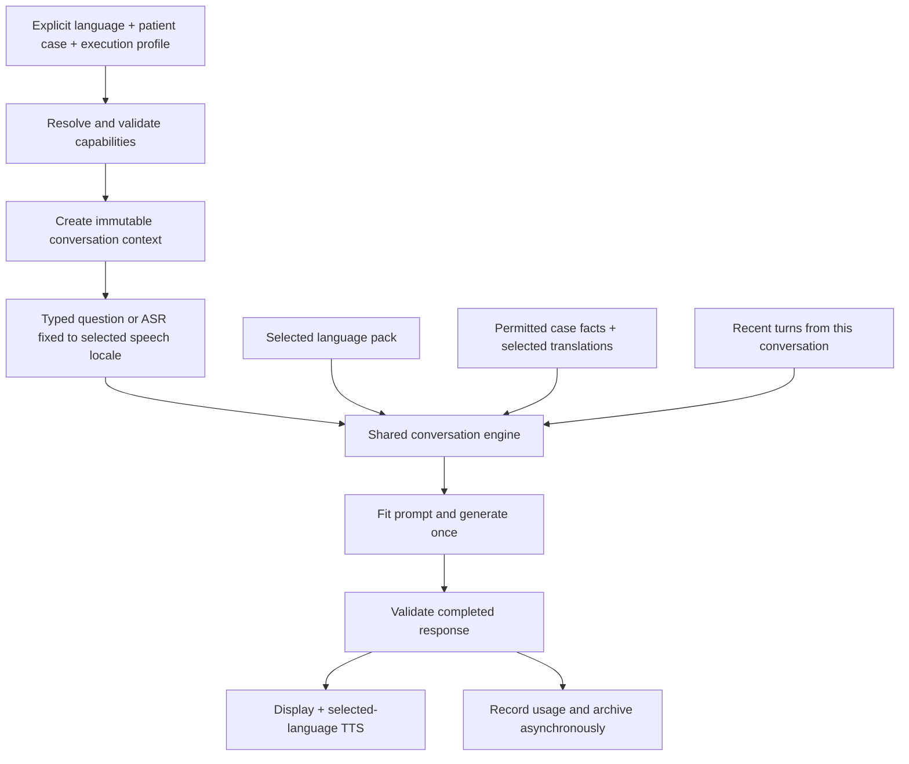

# Pluggable conversation languages: architecture and implementation plan

Date: 2026-09-24. Status: proposed; implementation paused for this design review.

This plan refines the [single-generation patient conversation plan](patient-conversation-implementation-plan.md). That replacement has work in progress in the workspace; it is not a completed or released implementation. This document takes precedence for language handling, sequencing, and acceptance criteria. English is the first language to complete and qualify. Hindi and subsequent languages are separate later deliveries.

The [detailed phased implementation plan](language-conversation-phased-implementation-plan.md) expands the sequence below into work packages, affected modules, API/storage contracts, dependencies, tests, and exit gates. Use its phase numbers to track execution.

## 1. Decisions

Use **one shared conversation engine, versioned language packs, localized case content, and independent model/speech adapters**. Both the desktop and platform use the same contracts and prompt compiler.

- Remove Auto from the patient conversation flow, including settings, request contracts, speech startup, and inference. English is an explicit initial selection.
- Fix the selected language for the life of a conversation. Changing it starts a new conversation with empty dialogue history.
- Keep personal and clinical facts, disclosure policy, authorization, history management, and call accounting in shared code.
- Put vocabulary, register, grammar guidance, script, clarification wording, and spoken-text preparation in the selected language pack.
- Keep language support separate from model/provider selection. Installing a pack does not establish that an LLM, recognizer, or voice works well in that language.
- Generate directly in the selected language with one LLM call. Do not add a per-turn translation, routing, or review call.
- Initially enable only the English conversation pack. Preserve existing Hindi content and historical records; Hindi remains unavailable for new conversations until its separate qualification is complete.
- Use modules inside the existing repository and services. Separate language services, plugin marketplaces, and arbitrary downloaded executable plugins are unnecessary for this scale.

UI language is a different preference from conversation language. This work localizes the interview behavior and language choices; translating every administration screen is a separate task.

## 2. What needs to change in the current code

The repository already has useful foundations: a platform language catalog, speech adapters, versioned profiles, immutable case snapshots, and private conversation archival. Reuse them.

| Current location | Limitation | Planned change |
| --- | --- | --- |
| `shared/training-contracts/.../patient_conversation.py` | In-progress language rules and text fallback contain English/Hindi branches | Inject a validated language pack into a language-independent compiler |
| `shared/training-contracts/.../scenarios.py` and `__init__.py` | Bilingual fields name `en` and `hi` explicitly | Generic localized-text contract for the new authoring format, with bounded language maps |
| `human-test/.../app.py`, `config.py`, and startup scripts | Language choices and ASR restrictions are repeated | Consume a resolved capability catalog and immutable conversation context |
| `human-test/.../controller.py` and speech code | Selection, inference, and playback must agree across asynchronous work | Pass the same context through recognition, generation, playback, history, and cancellation |
| API practice, completion, speech, and event schemas | Several different `en`/`hi`/`auto` enums | Shared language-tag validation plus registry/capability checks at execution boundaries |
| Platform settings and `/api/v1/languages` | Catalog availability alone does not prove conversational support | Keep the catalog; add computed readiness for the selected case, profile, and execution host |
| Case/identity/category database fields | Several translated values use `_en` and `_hi` columns | Generic localized text where these fields participate in patient setup; keep one set of clinical values |
| History, configuration hashes, and metrics | Insufficient language-pack/version provenance | Record the immutable context and version identifiers for each turn |

Legacy archived documents can remain readable through a format adapter. There will be one active conversation execution path. Generic non-conversation media APIs are not automatically stripped of detection features; patient conversations always pass an explicit language to them.

## 3. Runtime architecture



The engine owns this order:

1. Validate scope, active conversation, sequence, configuration, and input bounds.
2. Project permitted facts. Remove instructor-only and `never` content **before** selecting translations or building any prompt/cache entry.
3. Render the selected language's case wording; retain numeric values, units, explicit negatives, and unknown states.
4. Build shared behavioral rules, the selected pack's instructions, complete permitted case facts, recent complete dialogue pairs, and the current question.
5. Count tokens using the actual model/template, trim oldest dialogue pairs if necessary, and reserve response space. Never silently discard required case facts. Report insufficient model capacity before generation when the complete case cannot fit.
6. Make one answer-generation call through the chosen provider adapter.
7. Check completion status and output shape; display and speak only an accepted response. Language checks must tolerate proper names and approved borrowed terms and must not equate an unfamiliar word with wrong-language output.
8. Append the accepted exchange and record timing/usage. A failed or cancelled turn does not become successful history.

No automatic second generation, cross-provider retry, or language switch follows a failure. Errors remain errors; they are not archived as patient answers. Normal general questions still go to the LLM, without requiring authored answers.

## 4. Language pack contract

Proposed package layout, within the existing shared distribution:

```text
shared/training-contracts/src/training_contracts/
  languages/
    contracts.py             # LanguageTag, LanguagePack, validation interfaces
    registry.py              # Trusted installed packs and version lookup
    capabilities.py          # Pure capability-resolution rules
    packs/
      en/
        manifest.json
        instructions.txt
        phrases.json
        pronunciation.json
  conversation/
    context.py               # Immutable conversation identity and versions
    case_projection.py       # Disclosure-safe factual representation
    prompt.py                # One compiler, with an injected LanguagePack
    engine.py                # Budget, one generation, acceptance
```

Only English needs a real pack in this delivery. A synthetic second pack in tests proves that the core has no hidden English/Hindi branches.

| Pack field/resource | Responsibility |
| --- | --- |
| `language`, `version`, `contract_version` | Stable identity, immutable resource version, compatible pack interface |
| Display/native name and direction | Selection labels and left-to-right/right-to-left text presentation |
| Supported speech locales | Candidate locale mappings; actual installed/provider support is resolved separately |
| Instructions | Natural register, grammatical person/gender, script, borrowed-term and mixed-input behavior |
| Phrases/examples | Short unknown, clarification, and boundary examples; wording variations where the qualified model handles them reliably |
| Normalization | Conservative whitespace/Unicode cleanup; preserve numbers, negation, units, names, and the original transcript |
| Pronunciation resources | TTS lexicon and spoken rendering of abbreviations/numbers, without changing the clinical meaning |
| Evaluation fixtures | Language-specific paraphrases, grammar, unknown facts, boundaries, follow-ups, and general questions |

Shared fact-grounding and safety rules cannot be weakened by a pack. Keep any clinical terminology exceptions language-specific, but evaluate meaning rather than treating a word such as a disease name as abuse. Abusive or sexualized requests receive a short boundary; legitimate clinical sexual-history questions remain answerable from the case or as unknown.

Packs are reviewed, bundled resources loaded through an explicit registry. An API request cannot name a filesystem path, load Python code, supply prompt instructions, or choose an uninstalled version. Optional Python hooks use a small declared interface and require normal code review. Credentials, tenant data, provider endpoints, and installed voice binaries never belong in a language pack.

Use language identifiers such as `en` and later `hi`, with registered script/region variants allowed by the contract. Keep the speech locale separate, for example `en-IN`. Provider adapters translate the resolved locale into the provider's identifiers. Do not scatter prefix matching or two-letter assumptions through consumers.

## 5. Case facts and translations

Use a new versioned authoring document with generic localized text. Keep it in the existing bounded JSONB case documents; a separate translation service or a new table per language is unnecessary.

Illustrative fragment, not a complete request schema:

```json
{
  "schema_version": 3,
  "source_language": "en",
  "patient": {"age_years": 35},
  "presentation": {
    "chief_complaint": {"en": "Burning when passing urine"}
  },
  "localizations": {
    "en": {"revision": 1, "source_hash": "<canonical-source-hash>", "status": "reviewed"}
  }
}
```

The actual contract retains structured presentation, history, topics, stable references, disclosure rules, and instructor fields. Replace `DraftBilingual` with a bounded language-to-text mapping. Give currently unkeyed translatable history entries stable IDs so translation review survives ordering changes. Scalars such as age, measurements, and sex remain one authoritative value.

- Each document has one authored source language. Translations refer to the same facts; they cannot add a different age, symptom, negative finding, or disclosure rule.
- Each localization records its revision and the canonical source hash it was reviewed against. Source edits invalidate affected language readiness; they cannot silently reuse stale approval.
- The server computes hashes and controls review/publish transitions. Clients cannot make content reviewed by submitting a flag.
- Publishing a language requires complete, reviewed patient-visible free-text coverage for that language. Numeric values and codes use the pack's renderer; they are not independently translated facts.
- Missing or stale translations disable that case/language combination with an actionable reason. The runtime does not omit facts or silently fall back to another language's text.
- Load only the selected language's permitted text into the prompt and conversation snapshot. Five other translations must not multiply input tokens.
- Bound language count, text lengths, document size, and snapshot size, and align API/database constraints and quota accounting. Validate representative six-to-eight-language fixtures against those bounds.

For the current cases, retain English and Hindi authored text during conversion; only English is reviewed/enabled in the first phase. Existing stored questions/topics become factual evidence and examples, rather than an exhaustive list of questions the engine may answer. Translate later case content during authoring and review, outside the answer path.

Identity, category, and case display text use the same generic localized-text type rather than more `_xx` columns. This does not introduce duplicate clinical values or translate stable database identifiers.

## 6. Conversation isolation and persistence

A proposed `ConversationContext` contains:

```text
conversation_id, organization_id, owner_id, department_id
case_snapshot_hash, practice_id, practice_revision
language, language_pack_version, localization_revision
conversation_policy_version, compiler_version
model_profile_revision, speech_profile_revision
configuration_hash, created_at, expires_at
```

The platform creates an immutable, tenant-scoped conversation record with the permitted snapshot and these references. Add a bounded `patient_conversations` table rather than using optional client-reported history as an authorization source. Existing selection is the editable setup; the conversation is the fixed runtime instance. Local inference remains local and uses the returned context; the platform does not proxy its model calls.

- Cloud execution validates the caller against the stored conversation on every request. Requests cannot override the session's language, pack, or case by posting different values.
- Local turn/history reporting validates context ownership and identity but remains labelled client-reported; recording a pack version does not attest what a laptop actually executed.
- Language, case, or incompatible execution-profile changes close the current conversation and start another. Ordinary question topic changes do not reset it.
- Use a conversation generation counter in the desktop to discard late ASR, LLM, and TTS results after reset/cancellation. Flush queued audio so an old reply cannot play in a new interview.
- History, caches, request fingerprints, and outbox records include conversation identity and relevant versions. Cache reuse cannot cross tenant/case/language boundaries. A global, content-free language-pack cache is safe.
- Keep exact turn idempotency, bounded sequence/concurrent-turn handling, cancellation, quotas, and retention. Archive retry must never rerun inference or replay audio.
- Pack updates take effect in new conversations. A missing pinned pack makes an existing session unavailable; it does not substitute the latest version.
- Recheck role, scope, lifecycle, profile, and connection permissions for online execution. A pinned snapshot does not grant continuing access after revocation. If an existing local offline authorization applies, retain its bounded expiry; immediate revocation cannot be guaranteed while disconnected. Language support must not extend that authorization window.

Reuse existing authentication, audit, profile, and archive mechanisms. Enforce foreign keys, server-side bounds, runtime grants, append-only context fields, and audited lifecycle changes in a forward migration. This is reproducible development schema work, not a production rollout or backup project.

## 7. Model and speech capability resolution

Extend the existing language catalog and model/profile metadata with operation-specific readiness. Resolve against the actual case, user scope, configured provider, and execution host.

```text
Text ready = enabled installed pack
             + current reviewed case localization
             + qualified configured LLM for this language

Voice input ready  = text ready + compatible available ASR/locale
Voice output ready = text ready + compatible available TTS/voice/locale
```

The UI can expose text, voice-input, and voice-output availability separately. A missing voice need not prevent an explicitly selected text-only conversation. It must not silently play another language's voice or switch execution to cloud.

An authenticated capability response for patient setup will include language code, display name, readiness per operation, selected pack version, and concise unavailable reasons. Keep `/api/v1/languages` as the platform catalog; add the case/profile-specific result to patient-practice capabilities. Local installation checks are combined with that result for desktop execution and cannot grant server permissions.

ASR receives an explicit language/locale. Any detected-language metadata is diagnostic and cannot change the conversation. Understand borrowed terminology or mixed input where the qualified model can do so, but answer in the selected language. An unintelligible input receives a short clarification instead of speculative translation.

LLM qualification is specific to the model/version, quantization, language, pack/policy, and execution settings tested. English success cannot certify Hindi. Prefer the existing provider interfaces; add a provider adapter only when an existing adapter lacks a required capability. Keep provider keys encrypted in PostgreSQL and local service keys local.

## 8. Calls, tokens, and latency

Language modularity adds resource lookup and deterministic rendering, not another LLM call. Cache immutable packs and case projections. Use one response-generation call for factual answers, generic questions, clarification, and boundaries.

Input budget is:

```text
shared rules + selected pack instructions + one permitted case localization
+ recent complete dialogue pairs + current question + model chat template
```

Previous tokenizer-only English drafts measured about 826-858 tokens without history and 995-1,027 with six short pairs. Those predate the fuller compiler and are not final estimates. An initial planning allowance is roughly **1,200-1,800 input tokens for short English cases with bounded recent history**, with exact counts reported for the finished implementation. Large cases and long questions can exceed that allowance. A 2,048-token model context cannot accept 1,800 input tokens plus a 256-token output allowance and safety reserve; fitting must use the actual remaining budget.

Start with a maximum 256-token response allowance for English, usually producing one or two short sentences. Six recent pairs are an upper bound, not a requirement to fill the context. Qualify larger context windows or different models per language/case when necessary. Do not assume equal token counts across languages.

Proposed acceptance targets on the current local GPU, warm model, one active conversation:

| Measure | Initial target |
| --- | --- |
| Answer-generation calls per successful turn | Exactly 1 |
| Accepted text response, p95 | At most 2 seconds after typed/final transcript submission |
| First audible response, p95 | At most 3.5 seconds after the user's actual end of speech |
| Language-pack overhead | No network request per turn; measure separately from inference |

These are targets, not established results or cloud/hardware guarantees. Report first-token, accepted-answer, end-of-speech detection, ASR, TTS startup, and first-playback times separately. Include cold start, cache misses, and the model/context configuration in the report. Initially buffer the short completed answer before speech so rejected/truncated output is not already spoken.

## 9. Implementation sequence and deliverables

### Phase 1: Contracts and extension points

- Add pack contracts/registry and the English resources.
- Define generic localized text, the conversation context, operation readiness, and stable hashes.
- Write synthetic second-pack contract tests proving no language-specific engine branch is needed.
- Remove Auto from new patient conversation contracts and reject ambiguous existing setup until explicitly selected and saved.

Deliverable: reviewed interfaces and English-only readiness, before broad runtime wiring.

### Phase 2: Case format and persistence

- Add the new authoring format and a deterministic reader/converter for current bilingual documents.
- Convert current case/identity/category representations without losing facts, negatives, units, disclosure, or retained translations.
- Add conversation records and version provenance through forward Alembic migrations; update models, schemas, grants, readiness checks, seed/install scripts, and database documentation together.
- Test fresh installation, upgrade, scope, retention, source-edit invalidation, concurrent selection/start, and case-content preservation on disposable PostgreSQL.

Deliverable: one immutable selected-language runtime snapshot per conversation.

### Phase 3: Shared engine and host integration

- Refactor the in-progress single-call implementation into the shared engine/compiler, injecting the English pack.
- Wire both local `human-test` and platform completion to the same prompt contract and context.
- Replace duplicated language enums and startup assumptions with validated capabilities.
- Align one-call quota accounting, event schemas, history/outbox, and cancellation.
- Keep new behavior scoped to patient conversation; preserve unrelated model-management UI work.

Deliverable: English text conversations using saved facts and general LLM responses with one generation.

### Phase 4: English speech and selection UX

- Show English as the explicit available choice; remove Auto. Future unavailable languages are not selectable as supported conversations.
- Resolve ASR/TTS and voice from the same context; validate missing or mismatched resources before recording starts.
- Test language/profile changes, stop/restart, delayed callbacks, queued audio, microphone errors, and text-only operation.
- Add the capability reasons and keep technical prompt/provider details out of the ordinary interview flow.

Deliverable: an English interview whose text, recognition, voice, and stored history agree.

### Phase 5: Evaluation, review, and fixes

- Run 15 live local-model questions in each of Cardiology, Nephrology, and Respiratory: 45 turns total. Include known case details, explicit negatives, unknown details, follow-ups, family relevance, greetings, generic knowledge, arithmetic, ambiguity, and legitimate clinical terminology.
- Separately run at least 200 English regression/held-out turns across all nine cases, including abusive/sexualized boundaries, prompt injection, hidden disclosure, long inputs, and topic changes. Keep held-out paraphrases out of prompt tuning.
- Add recorded-speech checks and live microphone/speaker trials; typed inference results alone do not validate speech latency or pronunciation.
- Score factual correctness, unsupported personal claims, question relevance, correct language, naturalness, and appropriate boundaries separately. Do not grade merely by keyword presence or an LLM judge alone.
- Require no critical fabricated personal/clinical fact, explicit-negative reversal, or hidden disclosure in the acceptance set; target at least 95% acceptable overall answers and the latency targets above. Report sample sizes and failures; passing does not guarantee every future answer.
- Verify identical prompt construction in local/cloud adapters with mocked cloud calls. Record live cloud measurements only if that specific verification is authorized and performed.
- Run relevant shared/desktop/API tests, API lint/format/type checks, and isolated PostgreSQL tests. Review authorization, concurrency, invalidation, errors, and compatibility; fix confirmed findings and rerun affected checks.

Deliverable: quality/latency evidence, remaining limitations, and final review findings with fixes. English is complete only after this gate, not when its menu appears.

### Later: Add Hindi, then other languages

For each language: add a pack; review case translations; qualify an LLM profile; configure/test ASR and TTS if voice is offered; run that language's conversation and speech evaluation; enable it in the catalog. Use a fluent reviewer for naturalness, register, grammar, and pronunciation. A genuinely new speech provider may need an adapter.

Adding a language should require **no new conversation state machine, routing pipeline, tenant authorization code, language-specific SQL columns, or extra generation calls**. New linguistic needs extend the declared pack interface once, with regression checks for existing packs.

## 10. Scope and completion boundary

The immediate implementation after plan review is the reusable architecture plus a fully tested English path. Hindi behavior, five other real packs, UI-wide localization, a translation management product, hosted deployment, and Raspberry Pi qualification are subsequent work. Existing unfinished single-call changes will be adapted to this plan; they are not presented as complete.

This planning revision involved code/document inspection and documentation changes only. It does not claim the proposed registry, generic case format, conversation table, or English acceptance gates have been implemented or passed.
