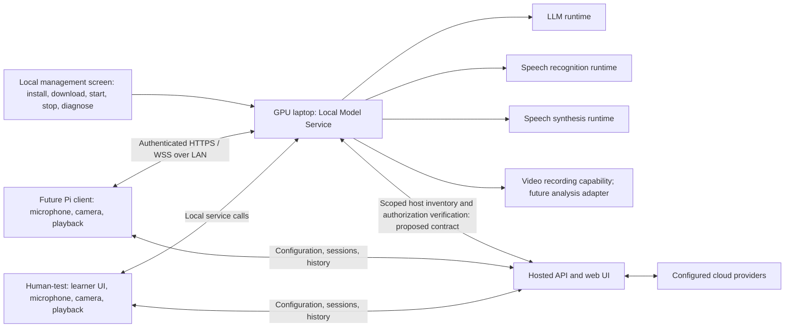

# Shared local model service on the GPU laptop

Recorded: 2026-10-09. Status: agreed direction for later implementation; documentation only.

Directory update, 2026-10-09: the existing `local-llm/` folder was renamed to
`local-models/`, including its installed assets and runtime state. Launch/import,
packaging and documentation paths now use `local-models/`. This prepares the
location for future work; the shared background-service design below remains
unimplemented.

The user wants local model inference, downloads, installation, removal, startup,
shutdown and diagnostics centralized on the GPU laptop. Human-test and a future
Raspberry Pi client will both consume these services. The Pi application will be
implemented later. This note changes no application code, model installations,
running services, API contracts, database schema or hosted deployment.

## Decision and purpose

Keep the hosted platform API/web UI as the authority for users, devices, tenant
scope, published scenarios, model assignments, authorized sessions and private
history. Introduce a separately installed **Local Model Service** on each GPU
laptop to own local execution and its lifecycle. Both clients use the same
versioned service contracts and installed model assets.

Centralized means one managed installation per laptop. The cloud API does not
invoke a laptop's private network endpoints, and installing this service does
not install another platform API or PostgreSQL database. Local inference remains
on the local network. Cloud model execution continues through the hosted API.

The diagram is a target architecture, not a statement that the LAN gateway,
service installer, host binding or future video analysis already exists.

## Current implementation to reuse

| Existing area | Current responsibility | Future ownership |
| --- | --- | --- |
| `local-models/` | Pinned model/runtime downloads, native llama.cpp API, CPU/CUDA selection | Managed LLM adapter and shared asset store |
| `device/audio-process/` | Separate resident speech-recognition service; supported CPU/GPU adapters | Managed speech-recognition adapter |
| Human-test speech/voice modules and voice installer | Local Piper synthesis, installed voices and physical playback | Synthesis and voice assets move behind the service; playback stays in the client |
| `device/video-process/` | Standalone compressed-video receiver and bounded private recording | Optional managed recording capability; no existing video inference |
| Human-test offline installer and companion supervisor | Coordinate required assets, owned processes, GPU sharing and startup | Independent laptop service manager |
| `shared/training-contracts/` | Patient context, clinical fact guards, prompt fitting and conversation contracts | Reuse from shared local conversation execution; do not duplicate patient rules in clients |

These are extraction/reuse candidates, not instructions to move or delete files
now. Current process ownership and loopback ports remain unchanged until a
reviewed migration. Current behavior is described in
[Human-test/API boundary](human-test-api-boundary.md),
[local LLM](../local-models/README.md),
[audio](../device/audio-process/README.md) and
[video](../device/video-process/README.md).

## Responsibilities after extraction

| Component | Owns |
| --- | --- |
| Hosted API/web UI | Identity, tenant/department permissions, scenario publication, device/model assignments, session authorization, quotas, retention and authorized history/media access |
| Laptop Local Model Service | Approved asset catalog, downloads, installed inventory, engine adapters, GPU/CPU scheduling, inference, service lifecycle and redacted diagnostics |
| Laptop management screen | Local operator actions to install/remove services and models, download/verify assets, start/stop/restart, view readiness and run explicit diagnostic requests |
| Human-test | Training interface, scenario/session interaction, local microphone/camera capture, physical playback and client session reporting; consumes service capabilities |
| Future Pi client | Device enrollment, scoped session/configuration interaction, microphone/camera capture, speaker playback and calls to the paired laptop or hosted cloud route |

Model installation on a laptop does not change a platform device assignment.
Local inventory and readiness are facts the service can report; Platform Admin
retains existing authority to configure and assign models. The laptop is an
execution host for paired devices, not automatically another enrolled learner
device. Host identity/binding and its accounting need explicit future contracts.

## Independent background services and management

Use one independently installed service manager with separately controlled
capabilities for LLM, speech recognition, synthesis and optional video handling.
Workers may be separate processes to isolate incompatible native dependencies.
The manager owns only its registered processes and never stops an unrelated
listener. Human-test consumes readiness and inference; opening or closing its
window does not install, remove or shut down shared services.

Windows on the existing GPU laptop is the first implementation target. Provide
an explicit OS background-service installation and removal workflow, optional
startup at boot, and a separate operator interface. The service runs with a
dedicated, minimally privileged identity and private storage. Installer-only
system changes are separate from ordinary inference. Selecting an OS service
wrapper and supporting another laptop OS are future implementation decisions.

Physical microphone/camera capture and speaker playback stay in Human-test or
the Pi. A background service generates speech bytes and processes submitted
media; it does not require desktop audio-device access. Booting or starting a
service must not start recording or open client microphones/cameras.

Keep these operations distinct:

| Operator action | Meaning |
| --- | --- |
| Install/remove service | Register/remove background execution and its owned binaries/configuration |
| Download/install model | Fetch and verify approved weights, voices or runtime assets into shared storage |
| Load/unload model | Allocate/release runtime resources for an installed model |
| Start/stop/restart capability | Control the corresponding worker with readiness checks and active-job handling |
| Remove model | Remove that verified local asset after checking active use and shared references |
| Diagnose | Inspect environment and readiness; explicitly request a bounded test inference when needed |

Service removal preserves model caches, recordings and private history by
default. Data deletion is a separate explicit action. Stop/restart/removal must
identify all affected clients, drain admitted work with a deadline or explicitly
cancel it, and prevent new admission. A Human-test exit releases its own session;
it cannot terminate a Pi session using the same worker.

## Model and capability management

- Maintain one verified asset store per laptop, separate from Human-test and Pi
  installation folders. Reuse existing pinned download/integrity logic and license
  metadata. Stage downloads atomically, allow bounded resumable download recovery,
  reject unapproved URLs/archives and preserve a previously working installation
  on failure. Installation never downloads automatically during an inference call.
- Report installation, process state, loaded model, warmup readiness and actual
  GPU/CPU execution separately. An installed model or listening process alone
  does not prove successful inference.
- Publish supported operations, model/artifact/runtime versions, languages,
  formats, context and output bounds, cancellation support and concurrency limits.
  A disabled or unavailable capability produces an explicit result rather than
  switching to another engine or a cloud provider.
- Load each required model once per compatible managed runtime and reuse it
  across client requests. Bound worker count, queue depth, memory and GPU use;
  start with explicit capacity limits, not an assumption that two clients imply
  two simultaneous GPU generations. Keep conversation histories and generated
  audio isolated by caller/session.
- Account for LLM, recognition and any future vision model sharing VRAM. Retain
  explicit CPU/GPU/offload policy and native verification. Not every operation
  needs GPU acceleration; the chosen engine determines supported execution.
- Treat video recording and video inference as separate capabilities. The
  existing recorder needs no analysis model. A future analysis model requires
  its own adapter, task definition, resource limits and qualification.

## Shared inference and patient behavior

Expose stable contracts for recognition, LLM completion, speech synthesis and
optional recording. A shared local patient-turn executor should use the existing
`training-contracts` conversation logic, immutable platform-issued context,
approved scenario facts and native token-budget checks. Human-test and Pi must
not grow separate prompt construction or clinical response implementations.

Client requests retain their authorized tenant/device/session, immutable scenario
snapshot and execution revision. Changing model assignments must not silently
change a running conversation. Cancellation, expired authorization, model
failure and unavailable GPU capacity need consistent events for both clients.
No prompt, result or cache from one client may become another client's context.

Unknown inference/submission outcomes are not automatically replayed. Status
inspection and explicit recovery must retain the original request identity.
Separately retryable history/media uploads do not rerun models or speaker output.

## Human-test and Pi access

Human-test connects locally to the manager; the future Pi connects to an
explicitly paired LAN endpoint. Keep native workers private to the laptop and
expose a dedicated authenticated gateway rather than opening every existing
loopback model port. LAN communication uses verified TLS and per-client
authorization. Control/download/delete endpoints are operator-only; paired Pi
clients receive scoped inference access, not service-management credentials.

Retain separate bounded audio and video streams as described in
[the transport decision](local-media-transport.md). Certificate trust, client
pairing, replay protection, disconnect handling and a versioned gateway contract
must be implemented and tested before advertising Pi support.

Pairing identifies a trusted execution host; it does not grant arbitrary access
to clinical documents or media. The hosted platform remains the authority for
active tenant/department/device state, scenarios and session grants. Do not hand
platform bearer credentials to native workers or expose provider keys to clients.
Local management credentials and device inference grants remain distinct.

Existing `execution=caller` routing assumes a model on the caller's laptop and
is insufficient for a Pi paired to a different machine. Specify a compatible
host-binding and authorization/revalidation contract before implementing that
route; do not publish a laptop's private URL as a cloud provider endpoint.
Local execution is not unrestricted offline training. Any offline allowance must
have explicit bounded authorization/expiry and cannot ignore revocation policy.

## Diagnostics and operator experience

The separate laptop management screen should show download progress, installed
versions, loaded models, service state, actual inference device/offload settings,
GPU memory availability, active/queued jobs, latency measurements, failures and
disk/storage use. Distinguish service health, model readiness, platform contact
and whether a specific client is paired and authorized.

Provide bounded explicit test requests for recognition, completion and synthesis;
display their actual success/error and timings. A driver probe or model catalog
check must not claim inference is verified. Diagnostics redact credentials,
tokens, prompts, transcripts, private media and signed URLs. Retain bounded logs
and no incidental training-data collection.

## Later implementation sequence

1. Define and test service/capability contracts, trust boundaries, resource
   admission and the platform host-binding/session authorization extension.
2. Implement the independent Windows installer/service manager, shared verified
   assets, operator controls and diagnostics, reusing existing engine adapters.
3. Extract local inference/voice synthesis and conversation execution behind the
   service. Preserve clinical guards and cloud/local parity; migrate Human-test
   to the client API without removing a working installation during transition.
4. Qualify inference, install/remove, crash recovery, GPU sharing, scoped concurrent
   clients and disconnect handling on the actual GPU laptop. Update portable
   packaging after qualification; cloud provider execution remains unchanged.
5. Implement the Pi app later: microphone/speaker/camera adapters, platform
   enrollment/session handling, gateway pairing and local/cloud routing. Test
   real Wi-Fi/audio/video, authorization expiry and playback separately.

Future acceptance must show that Human-test and a second simulated client share
the intended engine without duplicate unintended model loads; closing one client
does not stop the other; contexts never cross; stale/unauthorized requests fail;
download failures preserve valid assets; active model removal is controlled; and
uncertain generation or playback is never silently repeated. Native GPU tests
and Pi hardware tests are distinct from mocks and must be reported as such.

## Decisions to settle when work resumes

- GPU laptop specification, intended model sizes and concurrent device target.
- Approved model/runtime/voice catalog and required languages/latency target.
- Local management UI packaging, OS service wrapper, private storage and upgrade
  strategy; retain current working assets during migration.
- Versioned service endpoints, certificates/pairing and platform execution-host
  representation, authorization and device-seat accounting.
- Whether video needs only recording or a specified inference task.
- Any deliberately supported offline policy, independent of local inference.

The direction and scope above are recorded now. Implementation, model/service
installation, Pi code, deployment, commit and publication remain future actions.

## Desktop UI update - 2026-10-09

The standalone management interface is now present as **Manage Local Models** in
`local-models/desktop/`. Launch it with
`local-models/manage-local-models.bat`; see the
[desktop instructions](../local-models/README.md#manage-local-models-desktop-interface).
It provides the page layouts and sample-data previews for model downloads,
service provisioning, status, logs and settings. Operational controls remain
disabled. This implements the presentation only; the background-service manager,
shared asset/service contracts, real downloads through this UI, live diagnostics
and Human-test/Pi integration described above remain future work.

## Windows service queue clarification - 2026-10-09

During operational UI implementation, the user explicitly queued true Windows
service installation and machine-restart auto-start after completing the current
task and its two reviews. Independent background execution must already survive
desktop closure. The initial manager may run as a detached operator process;
Windows service registration, dedicated runtime identity and startup before login
remain the queued follow-on phase. The UI must keep boot-start controls disabled
until that integration is implemented and qualified.

## Operational desktop and local worker update - 2026-10-09

The default Manage Local Models desktop now connects to a detached authenticated
operator manager and resident LLM, speech recognition and synthesis workers.
Approved downloads, independent provisioning/start/stop/status, bounded logs and
export, revision-checked defaults, diagnostics and removal of stopped worker
configurations are implemented. The previous UI-only update describes the
earlier phase; --preview still shows explicit sample data.

Native CPU inference and continuity after actual desktop closure were verified.
The per-operator process is not a Windows service and does not auto-start after
reboot. Genuine Windows service install/remove and boot startup remain the
explicitly queued next phase. Human-test client migration, scoped platform
clinical/session contracts, GPU capacity qualification and authenticated TLS/LAN
Pi pairing remain separate work. No Pi code, deployment or publishing is included.
See [implementation reconciliation](../local-models/manager-review.md).

## Human-test client extraction - 2026-10-09

Human-test now consumes the inference-only shared client in local-models/client.
It no longer owns model downloads, provisioning, native runtimes or service
lifecycle. See [implementation and limits](local-model-client-migration.md).
Windows SCM/reboot startup, authenticated Pi LAN/TLS transport and video model
inference remain queued. Earlier phase descriptions are historical.
