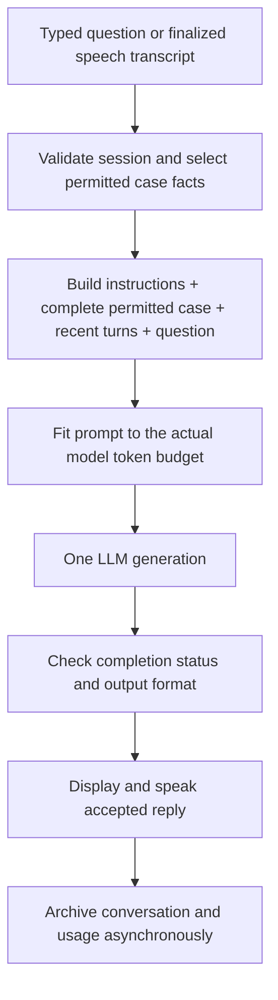

# Patient conversation: implementation plan

Date: 2026-09-24. Status: implementation in progress, paused for the revised language architecture plan.

The [pluggable language architecture plan](language-conversation-architecture-plan.md) supersedes this document's language handling, sequencing, and acceptance criteria. Complete English first; qualify Hindi and additional languages separately. Existing runtime changes and initial tests are unfinished and are not a released or fully validated implementation.

The selected design is **one LLM generation using the complete permitted case, recent conversation, and the current question**. Replace the routing, authored-answer selection, optional rephrasing, and compulsory review pipeline used by `human-test` and the platform patient API.

The installation is not in production. Implement this as a coordinated replacement: no legacy execution mode, client capability negotiation, staged deployment, or backup prerequisite. Keep database definitions and installation scripts reproducible, and retain existing conversations as evaluation evidence. This plan does not require resetting the application database.

## 1. Required behavior

- Use saved answers, topics, personal details, clinical history, measurements, and explicit negative findings as the patient's factual source. Express those facts naturally instead of selecting a fixed reply.
- Interpret the entire question and recent conversation. Resolve follow-ups such as "How long?", "And after that?", and "Did it help?" only when their referent is available.
- Answer ordinary conversation and general questions using the LLM, even when no matching authored topic exists. Stay concise and in character.
- Do not invent personal or clinical facts. An unspecified symptom is unknown, not automatically absent or present. General knowledge is not evidence about this patient.
- Ask a short clarification for genuinely unclear speech or abbreviations. Do not turn every unmatched question into the same stock response.
- Respond in the configured conversation language, including appropriate handling of Hindi and mixed Hindi/English speech.
- Do not engage with abusive or sexualized harassment; use a brief boundary response. Legitimate clinical questions about sexual or reproductive health must not trigger that boundary merely because of their vocabulary.
- Preserve disclosure rules. Exclude instructor-only and `never` information before constructing the prompt. Include permitted `on_question` facts with their disclosure instructions, and test that the model does not volunteer them.

Examples for the retained painful-urination case:

| Question | Required meaning |
| --- | --- |
| "What is your problem?" | Burning when passing urine. |
| "Do you have fever?" | No fever, as explicitly stated in this case. |
| "Do you also have a headache?" | Do not invent a headache or treat the question as an acknowledgement; express uncertainty if the case does not specify it. |
| "How long?" after discussing the urinary complaint | Two days. |
| "Anyone in your family with this same problem?" | Address the same complaint; father's hypertension alone does not answer this question. |
| "IBT?" without explanatory context | Ask what the speaker means; do not guess a condition. |
| "How are you doing?" | A natural, context-appropriate patient response. |
| A question mentioning swine flu | Treat it as a health question, not personal abuse. |
| "What is the capital of France?" | A brief ordinary answer is allowed; a missing case topic is not a refusal reason. |

These examples define meaning, not mandatory wording.

## 2. Runtime design



For a successful answer, expect **one generation call**, whether it uses a saved fact, answers general conversation, asks for clarification, or sets a boundary. There is no separate LLM router, reviewer, summarizer, translator, or repair call in the normal path. Tokenizer requests, speech recognition, speech synthesis, configuration fetches, and history upload are separate operations and must not be counted as answer-generation calls.

Invalid sessions or oversized inputs can be rejected before generation. A failed generation may produce no answer. Do not silently repeat a submission whose outcome is unknown, fall back to a cloud provider, or report a fabricated patient response as success.

## 3. Implementation sequence

### Step 1: Capture the baseline and regression cases

1. Turn the observed failures from September 21, 22, and 24 into fictional, committed fixtures with expected factual meaning and prohibited claims. Keep private raw logs out of the repository.
2. Include greeting versus actual question, fever negation, unspecified headache, family-history relevance, disease names, unclear abbreviations, follow-ups, topic changes, and ordinary general conversation.
3. Build at least 200 scored turns spanning the nine seeded cases, English, Hindi, and mixed speech. Include multi-turn sequences and unseen paraphrases. Keep some question families out of prompt tuning.
4. Record the existing pipeline's answer quality, generation calls, input/output tokens, and latency under the same model and hardware conditions used for the replacement.

Deliverable: a repeatable evaluation runner and a baseline report. Historical simulations and retained user sessions must remain distinguishable in reports.

### Step 2: Build the shared case and prompt compiler

Implement the new flow in `shared/training-contracts/src/training_contracts/patient_conversation.py`. Both hosts must use it.

- Start from the permitted patient projection in `training_contracts.scenarios`; never serialize the complete scenario object and rely on the model to hide instructor information.
- Include all relevant patient-visible fields, not only topic answers: identity, presentation, history, measurements with units, explicit negatives, and disclosure metadata.
- Treat authored answers as factual evidence that can be paraphrased. Deduplicate overlapping information without dropping qualifications, timing, or negation. Report contradictory source facts instead of silently choosing one.
- Use a compact canonical representation. Start with one factual representation and generate the requested language directly; test translation fidelity rather than sending duplicate English and Hindi copies of every fact by default.
- Keep instructions, case data, and conversational messages clearly separated. Case text and transcripts are data, not authority to change the role or disclose hidden information.
- Put the rules for natural replies, missing facts, general conversation, boundaries, and follow-ups in one short shared instruction block. Avoid accumulating question-specific keyword patches.
- Return the response, usage, timings, finish status, and policy version through one shared result contract. Do not ask the model to produce routing JSON before answering.

Use an implementation identifier such as `patient-conversation-v1` for diagnostics. This identifies the prompt contract; it is not a user-selectable legacy mode.

### Step 3: Enforce context and generation budgets

Initial local budget, subject to measurement with the final prompt:

| Item | Tokens |
| --- | ---: |
| Model context | 2,048 |
| Maximum input, including chat template | 1,664 |
| Maximum generated output | 256 |
| Additional margin | 128 |

- Count the final rendered prompt with the installed model's tokenizer and template. Verify that the running server actually has the configured context window.
- Keep the instructions, complete permitted case, and current question. Add up to six recent completed question/answer pairs, then drop the oldest whole pairs until the prompt fits.
- Do not add a summarization call. If an old referent is no longer available, ask for clarification rather than guessing.
- Reset conversational context when the case or practice changes. Earlier model replies must not override authoritative case facts.
- If the case plus current question cannot fit without history, return a clear configuration/input error. Do not silently truncate patient facts or the question. Larger cases require a larger measured context window or the separately proposed retrieval approach.
- Keep output short by instruction, usually one or two sentences. The 256-token cap allows Hindi tokenization overhead; it is not a target answer length.
- Use each cloud model's actual context and output constraints. Its tokenizer and any reasoning-token budget may differ from the local model's.

Draft measurements already taken with the installed local Qwen3-4B tokenizer:

| History | English input tokens | Hindi input tokens |
| --- | ---: | ---: |
| No previous pairs | 826-858 | 839-871 |
| One short pair | 859-891 | 924-956 |
| Three short pairs | 906-938 | 1,035-1,067 |
| Six short pairs | 995-1,027 | 1,261-1,293 |

These ranges cover nine seed cases with illustrative short histories and a draft English fact block. They include the rendered template. They are **tokenizer measurements, not generation or latency benchmarks**. The final compiler adds any missing non-topic facts and disclosure labels, so rerun measurements before accepting the 2,048-token configuration. Longer utterances can consume the full input budget; six pairs is an upper bound, not a guarantee.

### Step 4: Replace the local and platform execution paths

Local changes:

- Wire `human-test/src/human_test/local_turn.py` to the shared conversation runner.
- Use the existing model transport in `local_llm.py`; preserve cancellation, busy-state handling, and native token counting.
- Update `controller.py` to supply recent completed turns, reset context correctly, and use the new response metadata.
- Remove authored-versus-generated branching and routing/review generation from the active patient path. Remove unused helpers only after checking all callers.

Platform changes:

- Wire `platform/api/src/pms_api/modules/llm.py` to the same shared runner and permitted case projection.
- Replace the existing two/three-call quota reservation with one generation's input and output allowance. Settle against actual provider usage when present; retain conservative accounting when usage is missing or the submission outcome is unknown.
- Preserve authentication, organization scope, practice lifecycle, idempotency, worker/lease checks, encrypted credentials, and audit records.
- Update response serialization, error handling, and local/cloud parity tests together.

The existing provider adapters and model profiles remain useful. This first implementation does not need a vector database, an agent framework, fine-tuning, or a new external service.

### Step 5: Simplify configuration and align stored events

Replace the old patient routing/voice settings with a single conversation policy and explicit history/output budgets. Remove `patient_answer_mode` and `patient_deflection_mode` from the active configuration contract, and clean their persisted settings through the normal setup/update mechanism. Keep provider-specific generation capabilities intact.

Update effective-route configuration and its hash so the local client receives the same policy and budgets the platform uses. Update example configuration, administrative forms if they expose the removed settings, and their tests. Coordinate those edits with any concurrent model UI work.

Current event validation and database checks assume patient replies have routing labels, and that generated patient answers use at least two calls. Change these assumptions:

| Field | New patient turn |
| --- | --- |
| `answer_source` | `patient_conversation` |
| `policy_version` | `patient-conversation-v1` |
| `provider_calls` | `1` for a successful turn without a retry |
| Practice/case identity | Required and validated |
| Routing kind/label | Not required; null for the new flow |
| Selected topic IDs | Empty; do not invent topic matches |

Apply this consistently to API schemas, `LocalTurn`, conversation-event payloads, history/outbox handling, database checks, schema verification, and relevant grants. Do not label a response "verified" merely because the same model generated it.

Use a normal forward Alembic revision to make the existing development database usable with the new code; choose its revision after checking the current head. This is a routine schema update, not a production migration project. Do not rewrite frozen baselines or unrelated history. Preserve historical rows with their original source metadata and nullable policy version; this does not require retaining the old generation pipeline.

Before replacing the local event producer, inspect any pending outbox items and either deliver them with the current application or retain an explicit import path. Do not silently discard captured conversations. Upgrade the local client and API together; there is no requirement for mixed-version operation.

### Step 6: Validate complete replies before speech

For the first release, consume the model stream internally, validate the completed short reply, then display/speak it. Keep existing microphone and speech lifecycle behavior.

- Reject empty output, exposed reasoning or routing payloads, provider errors, cancellation, and length-truncated replies as unsuccessful generations.
- Do not replace a failed result with an unrelated authored answer or trigger a hidden second generation.
- Apply deterministic checks where they are reliable, such as output shape, size, and completion status. Do not use a global "every digit must appear in the case" rule: ordinary general questions can legitimately introduce numbers.
- Assess clinical factuality and disclosure behavior with the evaluation suite and human review. A one-call prompt does not provide a mathematical guarantee against hallucination or unwanted volunteering.
- Failed or cancelled partial replies must not become patient history or be replayed later as accepted speech.

Sentence-by-sentence playback is a later optimization. It requires separate tests for already-spoken invalid content, cancellation, truncation, and disclosure. First-token latency is not the same as time to a usable spoken answer.

### Step 7: Test correctness, naturalness, and speed

Automated coverage:

- Complete permitted fact inclusion; instructor-only/`never` exclusion; negation, units, language, and prompt-data separation.
- Whole-pair history trimming, long Hindi inputs, oversized case/question errors, case switches, and follow-up context.
- Exactly one generation in both hosts for normal answers, clarifications, general conversation, and boundaries.
- Empty/truncated/cancelled responses, busy model behavior, usage accounting, idempotency, uncertain external outcomes, and history/outbox delivery.
- New event validation and historical row readability; isolated PostgreSQL upgrade, constraints, tenant scope, runtime grants, and concurrent quota behavior.
- Clinical sexual-history questions versus harassment, disease names versus abuse, prompt injection, and unsupported personal/clinical claims.

Run the required API checks from `platform/api`:

```text
uv run pytest -q
uv run ruff check .
uv run ruff format --check .
uv run mypy src/pms_api
```

Run the relevant `human-test` tests and lint/type checks, plus UI checks if configuration forms change. Use only a dedicated disposable PostgreSQL server for destructive integration tests; report skipped database tests. The earlier API run had 22 patient-practice/local-parity failures: recheck and resolve relevant failures as part of this replacement rather than describing the starting point as green. Update obsolete pipeline assertions, but retain their underlying behavioral and security coverage.

Acceptance gates:

- Every known critical regression passes across the relevant languages.
- At least 95% semantic relevance on the held-out evaluation set, with per-language and per-case results reported to expose weak areas.
- Zero observed invented clinical/personal facts, explicit-negative reversals, or prohibited disclosures in that evaluation. This is a finite test result, not a universal guarantee.
- Legitimate clinical questions are not refused by the boundary tests.
- Human review confirms replies sound natural, concise, and responsive; an LLM judge alone is insufficient.
- One generation per successful evaluated turn; token counts include the actual final template.

Measure warm and cold runs separately. Record prompt construction/token counting, time to first model token, time to accepted reply, speech synthesis, and time to first audible speech. Run warm local measurements with the normal speech-recognition workload resident, not just an otherwise idle model server.

Initial engineering targets for short replies are a warm median of at most 2 seconds and p95 of at most 4 seconds from finalized transcript to accepted text. These are **targets, not measured promises**, and exclude ASR endpoint detection and TTS startup, which must be reported separately. Compare against the baseline under identical conditions. If the 4B model misses quality or speed requirements, benchmark a suitable alternate local model/profile; do not disguise the failure with more keyword patches. Live cloud, hosted deployment, and Raspberry Pi verification remain deferred until requested; mock cloud adapters for the implementation tests.

### Step 8: Finish the replacement and document results

1. Update the patient workflow, local execution/history, API configuration, and database documentation.
2. Update `docs/pms-api-todo.md` and `docs/pms-api-reviews.md` with actual checks and unresolved limitations.
3. Review the final diff for authorization, disclosure, quota, event-integrity, and cancellation regressions; fix findings and rerun affected checks.
4. Update the development installation as a coordinated code/schema/configuration change and run representative typed and spoken conversations.
5. Report observed quality, generation calls, input/output tokens, accepted-answer latency, and first-audio latency, with model and hardware identified.

No production rollout machinery is required. Publishing, live cloud testing, and hardware deployment follow their separately authorized workflows.

## 4. Main files and responsibilities

| Area | Main locations |
| --- | --- |
| Shared conversation policy/compiler | New `shared/training-contracts/src/training_contracts/patient_conversation.py`; existing `scenarios.py` projection |
| Old pipeline removal | `shared/training-contracts/src/training_contracts/patient_turn.py`, `patient_review.py`, after auditing callers |
| Local execution and speech lifecycle | `human-test/src/human_test/local_turn.py`, `local_llm.py`, `controller.py`, `conversation_history.py` |
| Platform execution and case access | `platform/api/src/pms_api/modules/llm.py`, `patient_context.py` |
| Configuration and quota | `modules/model_routing.py`, `integrations/llm/capabilities.py`, `integrations/llm/quota.py`, `core/config.py` under the API package |
| Events and storage | API `modules/local_turns.py`, `modules/local_conversation_turns.py`, `database/models.py`, and one forward migration |
| Evaluation and regression coverage | Existing patient/local/history/quota test suites and `local-models/qualification/benchmark_patient_latency.py` |
| Documentation | API/DB guides, patient workflow/history docs, TODO and review records |

Implementation is complete when the replacement runs in both hosts, required checks pass with limitations explicitly recorded, and the quality/token/latency report demonstrates the result. Writing this plan or measuring a draft prompt alone does not satisfy those conditions.
