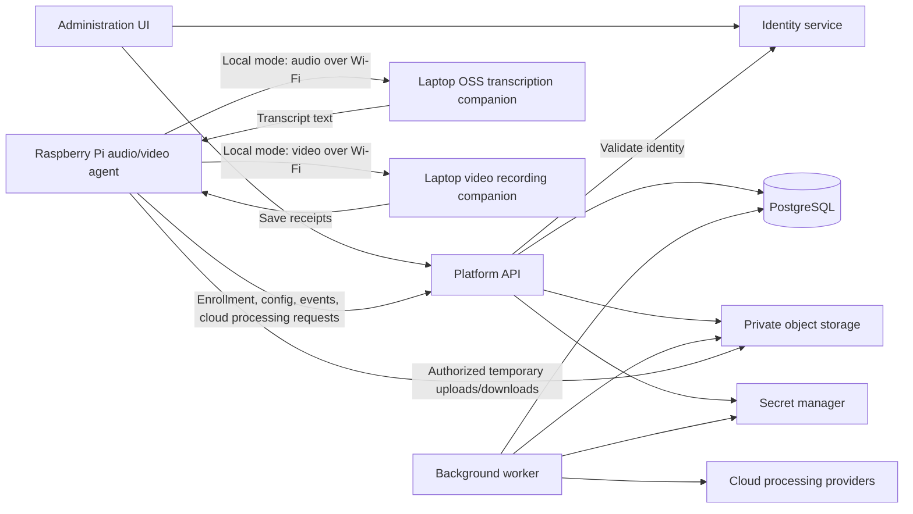

# Device Platform Service Plan

2026-10-09: compiler 38 scopes explicit questions to frozen case evidence, uses one
local generation and checks the complete 2,048-token budget, including output and
safety reserves. Migration `0048_refined_starters` refines the two bundled fictional
cases for new and unchanged existing tenants while preserving historical records.
Sessions now combines assignment outcomes, conversation and recording sync in one
history and details view. Conversation-history reporting defaults to enabled on the
API and laptop; explicit opt-outs remain configurable. See
[starter changes](compact-starter-scenarios.md) and [review evidence](pms-api-reviews.md).

2026-10-06 patient background: current authoring supports version 5 with optional
reviewed everyday background and author-approved choices, while retaining version
4 support. Conversation snapshots fix the background once; the local path uses
one generation with native context checks. Compiler 35 selects frozen facts for
new English personal/clinical answers; clear knowledge questions use a short
plain-text prompt. Older snapshots and other languages retain their reply
contract. Migration `0046_patient_background`
preserves existing documents. See [implementation TODO](patient-background-todo.md)
and [authoring guide](simulations/patient-background/README.md).

2026-10-04 scenario simplification introduced version 4 with Presentation & symptoms, History and eight Vitals. Q&A, Instructor content and fact-disclosure fields were removed by migration `0041_simple_clinical_cases`. Earlier version/lifecycle descriptions below are historical. See [scenario cleanup](scenario-simplification.md).

Updated: 2026-09-18 | Revision: 10  
Status: Implementation plan. The current API phase design is in [pms-api-architecture.md](pms-api-architecture.md); implementation and review status are tracked in [pms-api-todo.md](pms-api-todo.md). Service choices below are the proposed coding baseline; account values, languages, budgets, and operating defaults remain configurable.

Database field definitions: [platform/db/table-fields.md](../platform/db/table-fields.md).

Future manikin training features: [Patient Scenario Library](patient-scenario-library.md) records the agreed terminology, configurable clinical content, physical capability boundaries, and priorities for the next plan. Implementation status remains in TODO and the pilot runbook.

2026-10-01 tenant clinical ownership update: clinical specialties, fictional profiles, case Q&A, scenario drafts and approved versions are tenant-scoped in the current API and web console. Tenant administrators receive clinical author access by role and assign distinct capabilities to staff; separate reviewer, reader and training instructor capabilities remain assignable. Platform administrator status alone grants none of these. Rehearsal and training resolve approved tenant snapshots. The implementation and remaining rollout gates are tracked in [tenant clinical ownership](tenant-clinical-ownership-plan.md) and [review evidence](pms-api-reviews.md); earlier phase descriptions below are historical design context.

PostgreSQL schema v1: [installation and validation instructions](../platform/db/README.md), [installer](../platform/db/install.sql). Scripts cover the twelve tables, tenant constraints, lifecycle/admin guards, indexes, policy seed, and fixed role views. Apply the API migrations for the current subscription-enabled schema. Live cloud integrations and hosted deployment remain separate verification steps.

Default role catalog: [platform/db/default-roles.json](../platform/db/default-roles.json).

## 1. Purpose and scope

Build a cloud-hosted platform for organization/user/device registration, access control, and audio/video configuration. Raspberry Pi is the audio/video input and output device. In local mode, a connected laptop performs speech-to-text using a selected local open-source model; in cloud mode, the Pi requests processing directly through the platform API. A laptop can still stand in for Pi hardware during development. The confirmed execution split is detailed in section 7.1.

The initial platform should support:

- Platform administration, organization creation, user registration/invitations, and six default roles.
- Platform-wide configuration for registration, available providers, operating defaults, and policy limits.
- Device enrollment, active/inactive controls, registration dates, configuration, and credential revocation.
- Each device belongs to one organization, with optional department, location, and basic contact-person details: name, email, phone.
- Independent local or cloud execution choices for audio input processing, video processing, and optional audio output.
- Organization-owned connections to two cloud providers initially, with a third provider added through the same interface.
- PostgreSQL for application data, with device telemetry, last-seen/activity dates, processing history, and an administration UI.

First deliver management and telemetry using a laptop. Then implement local processing, **AWS first**, and **Azure second**, using the concrete operations in section 7. Google Cloud is an optional third integration after those pass acceptance tests.

Keep one backend, one database, and one Pi device agent, with a local laptop companion for transcription. Defer billing, department hierarchies, custom permissions, firmware updates, automatic provider fallback, and continuous cloud video. Start with short recordings/clips; the standalone local audio receiver has its own bounded session implementation and does not make the current cloud APIs streaming APIs.

## 2. Recommended architecture

| Component | Proposed implementation | Responsibility |
|---|---|---|
| Administration UI | React with TypeScript | Platform administration and organization workspaces, with role-specific navigation |
| Platform API | Python with FastAPI | Identity, permissions, enrollment, configuration, telemetry, processing requests |
| Background worker | Separate process from the same backend codebase | Cloud processing jobs, retries, cleanup |
| Database | Managed PostgreSQL; SQLAlchemy and Alembic | Application records, small job queue, schema migrations |
| Media storage | Private cloud object storage | Temporary clips, recordings, generated audio |
| Secrets | Encrypted PostgreSQL credentials; deployment key ring | Provider credentials encrypted with AES-256-GCM; keys and application secrets remain outside the database |
| Device agent | Python, with separate hardware and processing adapters | Pi microphone/camera input, speaker/display output, configuration sync, local companion requests and direct platform API requests |
| Local laptop video service | Standalone FastAPI receiver in `device/video-process`, port 8766 | Receive and save video only; private bounded segments, no live detection or analysis; optional offline JPEG extraction |
| Local laptop audio service | Standalone FastAPI receiver in `device/audio-process`, selectable multilingual Whisper models | Receive bounded authenticated audio, reuse one CPU model, print/return text and record audio/text in a bounded background store; optional future text callback |

Use an OpenID Connect (OIDC) identity service for signup, verified email, login, and password recovery. Validate its tokens; resolve application permissions from PostgreSQL. Select identity and invitation-email services during foundation work.

Deploy to one managed app/container hosting service. Hosting and processing providers are independent choices; connections must satisfy each processor's storage and regional requirements.

Initially queue jobs in PostgreSQL with transactional claims and expiring worker leases. Add a dedicated queue only when load requires it.

## 3. Small data model

Use thirteen tables, including the subscription-plan catalog, one platform-settings record, immutable profile revisions and telemetry history. Default roles use checked role codes and a fixed permission catalog, avoiding custom role/permission tables in the first release. Store variable settings/metrics in validated JSONB; keep relationships, lifecycle states, and frequently filtered dates explicit.

| Record | Minimum information |
|---|---|
| Organization | Name, description/contact, required subscription plan/assignment date, active flag, default profile, policy limits |
| Subscription plan | Standard/Advanced, price/currency/period, user/device caps, active flag, version and timestamps |
| Department | Organization, name/description, active flag; flat list |
| User | Identity issuer/subject, name/email, optional platform role, active flag, registration/login/activity dates |
| Membership | Organization, user or invitation email, role, department scope, active flag, invitation expiry/status |
| Device | Organization, fixed device role, optional department/location/contact, active/enrollment state, capabilities, applied revision/configuration hash, credential metadata, dates, latest health |
| Provider connection | Organization, label, provider/service settings, encrypted credential status/key ID, active flag, per-service validation status/date, last used |
| Processing profile | Organization, name, editable draft, current published revision |
| Profile revision | Profile, version, immutable settings, publisher/time |
| Processing run | Organization/device/department snapshot, capture ID, operation/revision, status/times, result/error, media/provider-job references, playback acknowledgment |
| Telemetry sample | Organization/device/department snapshot, observed/received time, compact metrics |
| Activity event | Organization/department context, actor/device, category/action/severity, affected record/run, time, brief structured details |
| Platform settings | Single global record: display name, signup mode, enabled providers, default organization policy, hard limits, device defaults, maintenance mode, version/editor |

Enforce tenant-aware foreign keys and one active membership per organization/user. Store invitation token hashes/expiry on pending memberships; verified, single-use acceptance activates membership. Index tenant filters, device status, and queued runs. Store media in object storage.

Use `created_at` and `updated_at` on mutable records, plus `is_active`, `status_changed_at`, and `status_changed_by` on organizations, departments, users, memberships, devices, profiles, and connections. Display `created_at` as the registration/creation date where no separate enrollment exists. Immutable revisions, runs, telemetry, and events retain their own lifecycle/timestamps rather than artificial active flags. All timestamps use UTC.

Keep device registration date (expose `created_at` as `registered_at`), `enrolled_at` (credential activation), `last_seen_at` (latest authenticated contact), and `last_activity_at` (meaningful processing/control event) distinct. Users similarly expose `created_at` as `registered_at`, with separate `last_login_at` and `last_activity_at`; organization activity excludes routine heartbeats. Capture agent-reported time separately from server receipt time so clock errors cannot change online status.

Location is a text label, such as "Pune office, reception." Contact name/email/phone grant no access. Optional model/serial/OS/agent-version details assist support; hardware identifiers are not credentials. Archive records needed by history.

### Organization subscriptions

Every new organization explicitly selects Standard or Advanced. Seed prices are INR 350,000 (3.5 lakh) and INR 500,000 (5 lakh). Confirmed configurable defaults are Standard: 200 users/1 device; Advanced: 500 users/3 devices. Billing period remains unspecified pending confirmation. Platform admins manage catalog values and organization plan changes; currency can be INR or USD; the platform administrator supplies the intended amount without automatic conversion. Plan selection does not collect payment. Platform administrators also manage manual subscription start/end dates, renewal, suspension/resumption and cancellation. The confirmed behavior is tracking only: these dates/statuses do not block processing, sign-in or historical access. Tenant administrators view their own subscription and seat usage; payment gateways and processing remain deferred. Existing plans and tenant activation are independent of recorded subscription status.

Active memberships and unexpired invitations occupy user seats, including admins and trainees. Active device records occupy device seats, including pending/revoked devices; deactivate/retire devices or deactivate memberships to free capacity. Acceptance, resend, reactivation, administrator assignment, plan downgrades and lower catalog limits all enforce capacity transactionally in PostgreSQL. Existing organizations adopt Standard without data loss; over-limit organizations are visible and cannot increase usage until capacity is freed or the plan upgraded. See [database/API subscription contract](../platform/db/subscriptions.md).

## 4. Platform administration, organizations, and default roles

Use six default roles. "Platform user" means a human assigned the **Platform Admin** role here; an ordinary registered account receives no platform administration rights.

| Role code | Scope and assignment | Responsibility |
|---|---|---|
| `platform_admin` | Human; users.platform_role | Manage organizations, global users/platform administrators, initial or replacement org administrators, platform settings, platform audit, aggregate health, and limited fleet registration/lifecycle/tenant association. |
| `org_admin` | Human; organization membership | Administer that organization's settings, members/roles, departments, devices, connections, profiles, processing, and audit. |
| `org_user` | Human; organization membership | Use assigned devices, start/stop enabled processing/playback, and read permitted results, configuration summaries, health, and operational activity. |
| `org_read_only` | Human; organization membership | Read permitted device information, results, health, configuration summaries, and operational activity; no control or configuration changes. |
| `org_trainee` | Human; organization membership | View device summaries, basic status, processing results, and media in assigned scope. No processing controls, detailed telemetry, configuration, or administration. |
| `org_device` | Non-human; fixed on enrolled device | Fetch its own configuration/work, submit its own processing/results/telemetry/events, and acknowledge playback. |

The earlier owner/admin/operator/viewer vocabulary is replaced by these codes. Human organization roles are stored per membership; one user may have different roles in different organizations. Org admins cover the whole organization; org users/read-only users/trainees may cover the organization or one department. Devices without a department require organization-wide membership. Trainee results/media access is confirmed; a training/course-management module is not added.

### Permission boundaries

| Action | Platform Admin | Org Admin | Org User | Org Read Only | Trainee | Org Device |
|---|---|---|---|---|---|---|
| Change platform settings/global users/platform admins | Yes | No | No | No | No | No |
| Create organizations; manage organization directory/status | All organizations | Own organization settings/status | No | No | No | No |
| Assign or recover org administrators | All organizations | Own organization | No | No | No | No |
| Manage org members/departments; private device configuration/enrollment | Requires org membership | Own organization | No | No | No | No |
| Register devices; edit public name/status and assign a tenant-published processing profile; revoke/retire | All unarchived tenants (active tenant for creation/activation) | Own organization | No | No | No | No |
| Transfer device registrations between tenants | Yes; fresh destination enrollment, source history retained | No | No | No | No | No |
| Manage provider connections/publish profiles | Requires org membership | Own organization | No | No | No | No |
| Read device summaries/basic status | Limited public fleet summary | Own organization | Assigned scope | Assigned scope | Assigned scope | Own status |
| Start/stop approved processing or playback | Requires org membership | Own organization | Assigned scope | No | No | Execute its authorized work |
| Read tenant results/media | Requires org membership | Own organization | Assigned scope | Assigned scope | Assigned scope | Own authorized results |
| Read configuration summaries/detailed telemetry/operational activity | Requires org membership | Own organization | Assigned scope | Assigned scope | No | Own permitted configuration/status |
| Read administrative audit | Platform and cross-org administration events | Own organization's administration | No | No | No | No |

Fleet administration uses `platform.organizations.manage`; fleet summaries use `platform.health.read`. A platform administrator can select an active, published same-tenant processing profile for a device after viewing only its per-operation routing metadata. Tenant administrators still publish the profile and own provider credentials; platform administrators receive no prompt, credential, draft, or media access. A transfer atomically retires/revokes the source registration and creates a new destination ID, inactive by default, without copying private fields, assignments or credentials. Tenant administrators configure and enroll the destination within their tenant. Device organization IDs and historical ownership remain immutable. Removal means terminal retirement; deactivation is reversible.

Platform permissions do not become an implicit tenant-data bypass. A platform admin needing tenant processing/data access must also have an explicit organization membership. Assigning such membership is audited, including self-assignment. Raw provider credentials are never readable through either administration UI.

Platform admins can create an organization and assign/invite its first org admin. When self-service organization creation is enabled, a verified user can create an organization and receives org_admin there. An email-domain match alone grants nothing. New organizations without an accepted administrator remain inactive; pending invitation acceptance remains available to complete onboarding.

Preserve at least one active platform admin and, for every active organization, one accepted active org_admin whose user is active. Demotion/deactivation checks run transactionally; global user deactivation must assign replacement org admins or suspend the affected organizations in that transaction. Bootstrap the first platform admin through a one-time deployment operation against a verified identity; no signup payload can request this role.

Evaluate current role, identity type, membership/department, and active flags on every API operation/download. Membership and platform-role changes take effect without waiting for login-token expiry. A human cannot select org_device as a membership role; a device cannot obtain a human or platform role. Default role grants are versioned application configuration, not user-editable permission JSON.

### Platform configuration

Only platform_admin can change platform_settings: platform display name, signup mode, enabled providers, organization policy defaults, global hard limits, heartbeat/control/telemetry defaults, and maintenance mode. Secret-manager credentials and deployment/database access stay outside this table.

Apply policy in this order: **platform limits > organization policy > profile restrictions**. Copy organization defaults at creation; changing defaults does not rewrite existing organizations. Global limits and provider disablement affect new work immediately. Maintenance mode pauses new enrollment/processing while preserving platform-admin recovery, read access, device health/status, and cleanup.

Increment configuration_version and audit each settings update. Device configuration acknowledgments include a hash of the resolved configuration as well as profile revision, so platform or organization policy changes propagate even without a new profile revision. Exclude volatile heartbeat/lease times from this hash. Offline devices apply changes on reconnect or stop at authorization expiry.

### Active/inactive behavior

| Inactivated record | Effect |
|---|---|
| Organization | Pause processing and ordinary member operations; keep device health/status and limited org-admin reactivation. Only platform_admin can lift a platform suspension. |
| Department | Pause processing for assigned devices and block new assignments. Organization admins can move/reactivate them. |
| User or membership | Block user actions globally or in that organization respectively. Org admins change their memberships; platform_admin changes global user status/role. Autonomous devices do not depend on their creator remaining active. |
| Device | Stop capture/processing/playback; retain authenticated heartbeat and status/config polling for diagnosis/reactivation. |
| Profile | Pause devices using it; do not silently select another profile. |
| Connection | Block only operations using it; unrelated local processing can continue. |

Evaluate parent and record flags together without rewriting child flags. Authorized admins operate within their scope and preserve administrator coverage. Reactivation revalidates configuration without restarting old sessions or replaying queued audio. Retirement/credential revocation rejects device authentication and requires fresh enrollment.

## 5. Device enrollment and lifecycle

1. Org admin registers the device, with fixed org_device role and optional department/location/contact/profile.
2. Generate a short-lived, single-use enrollment code; hash it, limit attempts, and consume it atomically.
3. Agent exchanges the code over HTTPS for its unique credential. Store only the server-side hash; protect the device copy.
4. Agent reports runtime version, hardware, and installed processing capabilities.
5. Agent validates/applies configuration and acknowledges its profile revision and resolved configuration hash. No valid profile means processing stays disabled.
6. Heartbeats report connectivity, applied revision, and health/errors.

Keep `is_active`, enrollment state (pending/enrolled/retired), connectivity, and health separate. An inactive device can be online, and an active device can be offline. Server revocation blocks new cloud operations immediately; an online agent stops on the next inactive/status response. Organization transfer requires fresh enrollment. Offline limits are defined below.

Use outbound HTTPS to the platform: heartbeat/config checks every 60 seconds, and control/result polling every 5 seconds during an active session, slowing when idle. Derive offline status after 180 seconds without authenticated contact. These are configurable defaults, not real-time guarantees. No inbound Pi ports are required; the planned local-mode Pi client connects to a separately authenticated laptop receiver on the local network.

## 6. Processing profiles and configuration

Use the device's assigned profile, otherwise the organization's default. Profiles can tighten organization limits, which in turn cannot exceed platform limits. Departments introduce no extra configuration inheritance.

Each profile contains three independent sections:

| Section | Small set of settings |
|---|---|
| Audio input processing | Enabled, operation, local/cloud engine, connection, language, capture format/duration |
| Video processing | Enabled, operation, local/cloud engine, connection, resolution/FPS/clip length, event cooldown |
| Audio output | Enabled, playback/synthesis engine, connection, language/voice, output format/volume |

Define capture activation, maximum duration, and event cooldown. Explicitly start a session before recording or event detection; startup alone does not activate it. Allow a fixed event-to-alert response. Speech synthesis takes text; playback uses an approved asset or generated audio. Playback always occurs on the device.

Local engines use installed code/models; speech transcription runs on the connected laptop, while lightweight Pi processing and physical output remain device responsibilities. Cloud engines reference organization-owned connections through the platform API. Validate the requested capability and execution host, not just the local/cloud choice. Laptop/model selection and capability reporting are planned contract extensions, not fields or engines already accepted by the current API.

Example: `audio.transcribe` through an AWS connection, local video recording, and local alert playback. A second profile can use Azure Speech for audio and AWS for video. Audio and video must not share a forced provider choice.

Validate settings, connections, and known capabilities before publishing; recheck on assignment/device receipt. Publishing updates the desired revision; acknowledgment updates the applied revision. Rejected updates retain the last valid configuration and expose the reason. Rollback publishes a new revision copied from an earlier one. Runs retain their revision and non-secret effective settings.

Cloud requests name their applied revision. Authorization mismatches require refresh, not silent provider substitution. Revocation overrides queued work. Preserve revisions referenced by devices or runs.

Unavailable engines report failure without automatic fallback. Expose only tested engines: motion detection is not object recognition, and sound activity is not transcription.

Offline local processing may continue until a server-issued expiry, provisionally 24 hours and capped by organization policy. Bound queued result metadata; raw-media buffering is off by default. Expiry pauses processing. Reconnect and synchronize before new work; mark late events as historical. Remote shutdown cannot be immediate while offline.

## 7. Audio/video architecture and service integrations

### 7.1 How the Raspberry Pi will work

Use **separate audio-input, video-analysis, and audio-output pipelines**, coordinated by the Pi agent. The Pi owns microphone/camera input and speaker/video-display output in both local and cloud modes. A Pi camera captures pictures/video; use a separate microphone for audio. USB cameras may expose a microphone, but the agent still selects audio and video inputs independently. Video/display output is a planned hardware responsibility; this decision does not add a video-generation service or an implemented video-playback API.

| Device responsibility | Initial implementation |
|---|---|
| Camera capture | OpenCV for laptop/USB cameras; Picamera2 for a Pi camera module |
| Microphone and speaker | Python `sounddevice`, with selected input/output device IDs |
| Local audio processing | NumPy/SciPy for level/activity detection and basic filtering |
| Local video recording | Separate laptop `device/video-process` API; receive and save only. Frame extraction runs offline; no live detection or image analysis. |
| Local speech transcription (planned) | Stream/copy bounded microphone audio to the connected laptop; its selected OSS model returns text |
| Audio output | Pi speaker plays approved recordings, alerts or synthesized audio; optional local eSpeak NG synthesis |
| Video/display output (planned) | Pi renders approved video or visual output on its attached display; player and delivery contract require implementation |
| Cloud processing | Pi calls the platform API without a laptop relay; authorized media uploads and provider calls follow the platform workflow, with provider SDKs and credentials on the server |

The [Pi camera stack](https://www.raspberrypi.com/documentation/computers/camera_software.html) and [sounddevice](https://python-sounddevice.readthedocs.io/en/latest/) provide separate capture interfaces. [eSpeak NG](https://github.com/espeak-ng/espeak-ng) provides a lightweight local synthesis option.

Start benchmarking with mono PCM WAV audio at 16 kHz/16-bit and short 5-15 second recordings, plus 720p H.264 MP4 video clips of 5-10 seconds. These are adjustable starting targets. Pi 5 uses software video encoding; monitor CPU, temperature, and dropped frames rather than assuming sustained 4K capture/analysis. The standalone local video receiver uses timestamped JPEG frames and MJPEG Matroska segments; the H.264 clip target is for platform uploads. Live local detection is outside its scope. [Pi encoding documentation](https://www.raspberrypi.com/documentation/computers/camera_software.html)

Use bounded queues and separate capture/processing tasks so video encoding or uploads do not block audio and heartbeats. Initially pause transcription capture during speaker playback; simultaneous listening/speaking needs echo cancellation. Report buffer overflow instead of allowing unbounded memory growth.

Attach a shared `capture_id`, capture start time, and relative timestamps to related audio/video runs. Each can succeed independently; the UI groups them. Video-only uploads omit microphone audio. A later explicit combined operation can send an audiovisual clip to [Azure Video Indexer](https://learn.microsoft.com/en-us/azure/azure-video-indexer/video-indexer-overview); enable cloud audio explicitly and avoid duplicate transcription. Combined live conversation is outside this release.

#### Confirmed local and cloud execution split (2026-09-17)

The standalone local video receiver is implemented in [device/video-process](../device/video-process/README.md), independently on port 8766. The confirmed scope is **receive and save only**: no detection, live image extraction, decoding or re-encoding. Timestamped baseline JPEG packets are saved as private, bounded, playable MJPEG Matroska segments by a background writer. A separate offline CLI extracts original JPEGs from completed recordings while the recording API is stopped. The receiver has its own authentication, quotas, retries and owner-scoped save receipts; it has no PMS, audio-service, database or cloud connection. Pi capture and Wi-Fi/TLS hardware integration remain deferred.

The standalone local audio receiver is implemented in [device/audio-process](../device/audio-process/README.md). It receives audio on an authenticated WebSocket, reuses one startup-loaded/warmed CPU model, and prints text to the laptop console and returns it on the stream. Private background WAV/UTF-8 transcript recording is enabled, capped at 1 GB/1,000 sessions with seven-day retention. Its independent bounded writer reports pending/saved/incomplete status without making transcription wait for disk. Safe transient writes use bounded retries; component failure can preserve text-only or audio-only storage, with explicit finalization/completeness status. Future callback retries are limited to pre-submission connection failures. An optional fixed text callback is disabled until a receiver is chosen. This service has no connection to PMS, its database, or cloud providers. The platform-integrated routes below remain future work; Pi hardware and platform run/configuration binding are not implemented by this receiver.

| Mode | Processing route | Output route |
|---|---|---|
| Local speech-to-text | Pi microphone -> local Wi-Fi -> laptop receiver -> selected installed OSS model | Laptop returns transcript text to the Pi; the Pi submits authorized normalized results under its existing device/run identity |
| Cloud processing | Pi -> platform API -> platform worker -> configured cloud service; no laptop dependency | Pi retrieves authorized text/media through the platform workflow and presents it through its speaker/display as appropriate |

- **Laptop target:** Windows, 16 GB RAM, CPU execution. Keep the OSS engine/model configurable. Whisper `large-v3` with CPU INT8 is an accuracy-focused candidate; `large-v3-turbo` and smaller multilingual models are alternatives to benchmark. Other OSS models require their own validated adapter. No model or real-time latency is guaranteed by the RAM size alone. Hindi and English are required; test mixed Hindi-English speech explicitly before claiming support.
- **Local connection:** Wi-Fi is the preferred first implementation. Keep separate authenticated WSS connections for audio (8765) and video (8766); both already run over TCP. A raw TCP listener is deferred pending demonstrated benefit. The video sender uses a bounded four-frame window with concurrent receipt handling; audio already sends and receives concurrently. See the [transport decision and controlled comparison](local-media-transport.md). Bluetooth is optional future transport, not required for the prototype. Preinstalled local models do not require cloud inference; platform configuration, result reporting and offline authorization still follow platform policy.
- **Local access and failure behavior:** bind companion access to the authorized Pi/device and current configuration without sharing its platform bearer credential. Keep media private, queues and retention bounded, and reject stale/session-mismatched results. An unavailable laptop/model pauses or fails local transcription; never silently send local audio to cloud processing. Local network connectivity and unexpired authorization are both required when operating offline from the platform.
- **Cloud boundary:** "directly" means the Pi contacts the platform API itself. The platform authorizes work and invokes AWS/Azure or a later supported provider. Only API-issued, scoped media upload/download access may go directly to storage; provider credentials and inference calls remain server-side. Audio/video capture and physical output stay on the Pi.

This decision assigns local speech-to-text and the separately requested video recording API to the laptop. Video analysis is not enabled in that recording API; any future bulk analysis and speech synthesis remain independently configured capabilities. Validate the standalone receiver's selected model on the target hardware and implement the platform configuration/capability extensions and video/display output contract before advertising integrated operation. Benchmark accuracy, transcription delay, sustained throughput, disconnect recovery and concurrent Pi audio/video input/output on the intended hardware.

### 7.2 Exact cloud operations to build

Implement AWS first: its dedicated audio and video APIs fit separate pipelines and provide an initial complete route. Azure is the second route, with independent Speech and Video Indexer adapters. This order is a design recommendation, not a performance ranking.

| Platform operation | AWS implementation | Azure implementation |
|---|---|---|
| `audio.transcribe` | Amazon Transcribe: `StartTranscriptionJob`, then `GetTranscriptionJob`; WAV staged in S3 | Azure Speech fast transcription: upload completed audio to the REST transcription endpoint |
| `audio.synthesize` | Amazon Polly: `SynthesizeSpeech`; return audio plus its actual format/sample rate | Azure Speech text-to-speech REST API; return generated audio with format metadata |
| `video.labels` | Rekognition Video: `StartLabelDetection`, then `GetLabelDetection`; H.264 MP4 in S3 | Azure AI Video Indexer: upload a private clip, poll indexing, read label insights with start/end times |
| `image.labels` (optional after clips) | Rekognition Image: `DetectLabels` on a selected JPEG frame | Not in the first Azure adapter; hide this combination |

Speech interfaces: [AWS transcription input/output](https://docs.aws.amazon.com/transcribe/latest/dg/how-input.html), [Azure fast transcription](https://learn.microsoft.com/en-us/azure/ai-services/speech-service/fast-transcription-create), [Polly synthesis](https://docs.aws.amazon.com/polly/latest/APIReference/API_SynthesizeSpeech.html), and [Azure synthesis](https://learn.microsoft.com/en-us/azure/ai-services/speech-service/rest-text-to-speech).

Video interfaces: [AWS start](https://docs.aws.amazon.com/rekognition/latest/APIReference/API_StartLabelDetection.html), [AWS results](https://docs.aws.amazon.com/rekognition/latest/APIReference/API_GetLabelDetection.html), [Azure upload/API](https://learn.microsoft.com/en-us/azure/azure-video-indexer/video-indexer-use-apis), [Azure label insights](https://learn.microsoft.com/en-us/azure/azure-video-indexer/labels-identification-insight), and optional [AWS image labels](https://docs.aws.amazon.com/rekognition/latest/dg/images-s3.html). Azure Video Indexer API use requires a standard account; portal trial access is insufficient.

Normalize transcript text/segments, generated-audio references, and video labels with confidence/time offsets. Preserve engine identity and optional native fields: providers need not produce identical labels or timing. Initially poll job status with backoff; SNS or webhook integration is optional. AWS Rekognition Streaming Video is unavailable to new customers and is not part of this design. [AWS availability](https://docs.aws.amazon.com/rekognition/latest/dg/streaming-video.html)

Keep operation support, languages, formats, regions, and adapter API versions in a small code-defined registry. Pin API versions in adapters, not editable user settings. Local mode offers only installed capabilities; selecting local transcription must remain unavailable until that engine is tested. A third provider can later add Google Speech-to-Text, Text-to-Speech, and Video Intelligence without changing device contracts.

### 7.3 Connection forms and authentication

Connections belong to an organization and are reusable across devices. Profiles select a **connection plus service/operation** independently for audio, video, and output. AWS can reuse one connection across its three services; Azure Speech input/output can share a connection, while Video Indexer needs its own resource settings.

Common fields: label, provider, connection type, active flag, non-secret settings, encrypted credential status/key ID, validation result per service, `last_validated_at`, and `last_used_at`. Do not ask users to provide every possible provider field.

| Connection type | Required non-secret settings | Authentication/secret inputs |
|---|---|---|
| AWS processing | Region; S3 staging bucket and prefix for Transcribe/video; permitted services | Workload role when hosted in the account, or organization role ARN with platform-generated external ID and an agreed trust policy; access-key ID/secret only as an explicit alternative |
| Azure Speech | Resource endpoint and region; resource ID when required by the chosen identity method | Speech resource key, or workload identity; cross-tenant service principal uses tenant ID, client ID, and secret/certificate |
| Azure Video Indexer | Subscription ID, resource-group name, account resource name, Video Indexer account ID, location | Workload identity or tenant/client ID plus secret/certificate with permission to generate account access tokens |

AWS cross-account access needs a configured platform caller identity plus an organization-specific [external ID and role trust](https://docs.aws.amazon.com/IAM/latest/UserGuide/id_roles_common-scenarios_third-party.html); a role ARN alone is insufficient. Azure Video Indexer obtains a short-lived account token through the [ARM token API](https://learn.microsoft.com/en-us/rest/api/videoindexer/generate/access-token?view=rest-videoindexer-2025-04-01). Refresh temporary credentials automatically; do not store temporary tokens as permanent keys. Provider credentials are independent of user login.

AWS batch audio/video requires S3 staging in the selected service region. Azure Speech fast transcription uploads bytes; Video Indexer can receive bytes or an authorized temporary URL. Use the platform's private storage where compatible and track provider copies for cleanup. Hosting in another cloud can add transfer cost and latency.

Connection setup must validate identity, region/resource, each enabled operation's permissions, and read/write/delete access to staging storage. Check available locale/voice combinations. Expose a separate small sample test because identity validation alone does not prove processing works; a successful Speech test must not mark Video Indexer validated.

Store provider credentials encrypted in PostgreSQL with AES-256-GCM; resolve them only on the server using a deployment key ring. Return credential-presence status only. Rotation resets validation. Inactivation blocks future dispatch while preserving restricted cleanup access; recheck each service before reactivation. Scope permissions to selected APIs/buckets, allowlist endpoints, and never send provider keys to the device.

## 8. Processing flow and reliability

**Local:** the Pi captures input. For speech-to-text it sends bounded audio to the connected laptop's selected OSS model, receives text, and reports compact results under the Pi's authorized run. Other local operations use their configured installed processor; physical audio/video output remains on the Pi. Local-only mode sends no raw audio/video to cloud processing. The standalone receiver is available; the Pi-to-platform result bridge remains future work described in section 7.1.

**Cloud input processing:** the Pi calls the platform API directly to create an authorized run, obtain an object-specific temporary upload URL, upload media, then finalize the upload. Only verified uploads enter the queue. The worker rechecks device/organization/connection status, stages media if required, invokes the provider, and saves results. The Pi polls status and downloads authorized outputs. The laptop is not a cloud-mode relay or prerequisite.

**Speech generation/output:** submit bounded text or an approved alert reference, not an unnecessary media upload. Synthesis returns audio; the agent reports playback success/failure separately from synthesis success. Device-local playback avoids a cloud processing job.

One run represents one operation: ID, engine, revision, timestamps, status, and result. States cover awaiting device/upload, queued, running, succeeded, failed, and cancelled/expired. Track playback separately. Org user/admin requests reach the device through polling and allow only fixed approved operations.

Use idempotency keys, deadlines, bounded retries, and worker leases. Persist provider job IDs; reconcile uncertain submissions before retrying. Deduplicate playback persistently and expire stale outputs. Do not replay uncertain outputs automatically; power failures prevent an exactly-once playback guarantee.

Reserve usage atomically and recheck authorization before dispatch. Inactivation cancels affected pending work; cancel affected running provider jobs where supported, otherwise suppress delivery and clean outputs. Interactive streaming needs a separate session path.

## 9. Telemetry, activities, and last-active tracking

Treat health measurements, processing results, and activities separately while using one device page to display them.

| Data | Initial contents and behavior |
|---|---|
| Latest device health | Uptime/boot ID, agent/OS version, CPU/memory use, disk free, temperature if available, camera/microphone/speaker state, applied revision, pending work |
| Processing health | Capture FPS/dropped frames, audio overflow/underrun counts, processing latency, upload failures, last error code; send only supported metrics |
| Telemetry history | Update device's latest snapshot every 60-second heartbeat; store one historical sample every 5 minutes with observed/received timestamps |
| Activity timeline | Registration/enrollment, login/invitation, active/inactive changes, config publish/apply/reject, online/offline transitions, capture start/stop, run failures/completions, playback, credential rotation |

Keep administrative audit and operational activities in one append-only activity_events table. Global settings/role changes use platform context; actions on an organization retain that organization's ID and the actor's authorization scope. Org admins read their org audit; platform admins read platform/cross-org administrative audit. Operational details/results still require membership. Devices submit only their own operational events. Reference runs rather than copying media/transcripts, and emit connectivity/error transitions rather than heartbeat activity rows.

The device submits batches with unique event IDs and boot/sequence identifiers for deduplication. Record server receipt time independently; reject malformed or oversized payloads and rate-limit ingestion. Missing laptop/Pi metrics are null, not healthy zero values. The server derives online/offline from `last_seen_at`; active/inactive remains administrative. Backfilled events retain their original capture time and do not falsely report recent live activity.

Proposed retention: 7 days of sampled telemetry, 30 days of operational activities/results, and 90 days of administrative audit. Store latest health on the device record. Use ordinary indexed PostgreSQL tables initially; add aggregation/partitioning only after measuring volume. No dedicated telemetry platform is needed for the first release.

## 10. Initial UI and API boundaries

Provide a platform-admin console for organizations, global users/administrators, platform settings, aggregate health, and administrative audit. Organization workspaces retain six areas: organization/departments, members, devices, profiles, connections, and activity/results. Show navigation/actions by role, with matching server enforcement. Device details retain registration, last-seen/activity, configuration, telemetry, and timeline views.

Group API routes under `/api/v1`:

- `/me` and `/organizations`: identity mapping, organization creation and selection.
- `/platform/settings`, `/platform/organizations`, `/platform/users`, `/platform/audit`, `/platform/health`: platform_admin only; organization-admin assignment is a dedicated organization subroute.
- `/organizations/{id}/{members,departments,devices,profiles,connections}`: organization-scoped administration; braces here abbreviate separate route groups.
- `/device/enroll`, `/device/config`, `/device/heartbeat`: device identity and synchronization.
- `/device/events` and `/organizations/{id}/devices/{device_id}/telemetry`: batch activities and scoped telemetry history.
- `/organizations/{id}/activities`: filtered activity/audit history. Entity update routes handle active/inactive changes and emit an activity event.
- `/device/runs` and `/organizations/{id}/runs`: submit/fetch work, finalize uploads, report results/playback, and obtain authorized media access.

Derive authorization from identity and server-owned assignments, never client-supplied tenant IDs, storage keys, or provider overrides.

## 11. Storage and operational defaults

- Require HTTPS, private media storage, scoped temporary URLs, and encrypted managed storage.
- Delete temporary raw media after completion. Propose a 24-hour application-storage limit; expire unfinished work before that deadline. Track cleanup for failed uploads, generated audio, staging objects, and provider copies. Provider-managed retention may differ: validate it against the organization's policy before enabling that service and surface deletion failures.
- Apply section 9's retention defaults, including transcripts in result retention. Administrative audit uses a longer policy than operational events even though they share a table.
- Limit upload size, clip duration, concurrent jobs, and daily usage. Check actual media size/type/duration after upload; a filename or declared content type is insufficient. Use expiry cleanup for abandoned uploads.
- Log request/device/run identifiers and diagnostic status; exclude credentials and media/transcript content by default.
- Back up PostgreSQL and verify restore. Track device connectivity, job failures, queue age, and provider latency.

## 12. Delivery plan and acceptance checks

| Phase | Deliverable | Completion evidence |
|---|---|---|
| 1. Platform foundation | Platform-admin bootstrap, fixed six-role catalog, platform settings, organizations/members, audit and UI | Platform management works; trainees have only permitted views; org roles cannot escalate; device credentials cannot use human APIs; last-admin checks pass |
| 2. Laptop management milestone | Enrollment, profiles/revisions, connection forms, status, telemetry, activity UI | Laptop reports health/dates; online versus inactive is correct; inactive parents block work but health continues; rollback works |
| 3. Local processing | Pi capture/output adapters, laptop OSS transcription companion, Wi-Fi sessions, model selection, audio activity/filtering, motion and optional eSpeak NG | Hindi/English accuracy and laptop CPU latency measured; bounded/disconnect-safe sessions; no local raw media sent to cloud; offline expiry and output controls work |
| 4. AWS integration | Transcribe, Polly, Rekognition video labels, IAM/S3 setup, worker | Real WAV, text, and MP4 samples pass; normalized outputs, staging, quotas, retries, cleanup, and inactivity checks work |
| 5. Azure / two-provider release | Speech transcription/synthesis, Video Indexer labels, separate connection validation | Each operation works through either implemented provider; mixed AWS/Azure profile works; unsupported choices remain disabled |
| 6. Raspberry Pi pilot | Pi microphone/camera and speaker/display adapters, laptop companion link, Linux service startup, ARM-compatible dependencies, bounded local buffers | Local transcription runs on laptop; cloud processing works through platform API without laptop; measure CPU, memory, temperature, audio delay, and video input/output throughput on hardware |

Test every role against allowed/denied routes, platform-admin access without tenant membership, last-admin transactions, settings precedence, policy-only config propagation, and maintenance exceptions. Retain tenant/department, inactivity/reactivation, enrollment, quota, worker, telemetry, retention, and real-provider checks.

Run the platform locally with development storage/secrets; test cloud storage in staging. Use the existing platform/api, platform/ui, platform/db, and device directories; separate Pi hardware adapters from the laptop companion and processing adapters. Install dependencies separately on Windows/Pi and verify ARM support during the pilot. The laptop companion is a processing helper for the Pi's logical device, not an automatically enrolled second device; any independently enrolled laptop still follows normal device-seat rules.

## 13. Remaining deployment inputs

1. Foundation: hosting cloud, identity/email services, first platform-admin identity, and signup mode. Proposed self-service mode grants a creator org_admin only; existing organizations require invitations.
2. Processing: Hindi and English are confirmed. Select voices, mixed-language/output-script behavior, regions, capture triggers/limits, and any business-specific analysis beyond the transcription/labels/synthesis baseline. AWS and Azure integrations are specified above; define the local streaming session contract before implementing it.
3. Performance: the local target is a CPU-based Windows laptop with 16 GB RAM, connected over Wi-Fi. Confirm the exact processor, Pi model, device count, media frequency/duration, acceptable delay and budget; benchmark candidate OSS models on the laptop and audio/video input/output on the Pi separately.
4. Operations: confirm proposed 24-hour offline authorization, 24-hour temporary-media limit, 7-day telemetry, 30-day results/operational activities, and 90-day audit retention.

Start with the management milestone; refine these decisions before their dependent phases.

## Confirmed implementation updates

Devices have optional `preferred_language`. English (`en`, speech locale `en-IN`) and Hindi (`hi`, `hi-IN`) are initially available. Platform administrators may add language choices or deactivate them. Unset/inactive selection resolves to English; a profile may explicitly override its speech locale. The effective language participates in the device configuration hash. This uses one small JSON language catalog in platform settings, without another table.

Provider credentials are stored encrypted in PostgreSQL, as requested. Encryption keys remain outside the database and are required to recover encrypted backups. All live external integration and hosted verification is deferred; local tests use PostgreSQL and mocked provider contracts. See the API architecture and README for the current executable scope, per-operation access validation versus sample runs, migration/adoption process and remaining deployment verification.

### Patient interview pilot implementation

The local interview path is implemented in `device/training`: the paired Pi captures microphone/JPEG camera input and plays speech; the laptop coordinates resident local ASR/dialogue/TTS, private recording and instructor review. Existing audio/video APIs remain standalone. Platform migration 0007 adds approved scenario versions, scoped session leases, quota reservations and manual feedback. Local model output selects an approved answer topic; it does not change clinical facts. Video has no model or live detection. Bulk sampled-frame replay is available after recording finishes.

Follow [the pilot runbook](../device/training/README.md), [design](patient-interview-pilot.md), and TODO/review evidence. The measured synthetic CPU pipeline does not yet meet the proposed latency/accuracy acceptance gate; actual Pi/Wi-Fi/16 GB laptop and educator validation remain separate work. Cloud mode still means Pi calls the platform directly; no laptop dependency or implicit cloud fallback was introduced by this local pilot.

### Patient Scenario Library database foundation

Migration 0008 adds private editable drafts and immutable publication provenance, with bounded storage, tenant references, edit revisions, and runtime grants. [Database documentation](../platform/db/scenario-library.md) defines installation and future API transaction responsibilities. Authoring endpoints, clinical contract version 2, UI, and new runtime behavior await the next authorized phase.

### Human microphone test and local LLM API

Migration 0009 and the PMS local LLM adapter now support authenticated JSON/SSE answers from a resident local llama.cpp server. `human-test/` contains a desktop screen that sends laptop microphone audio to the existing standalone ASR service, combines finalized chunks, submits the question through PMS and displays the answer. It does not change the training coordinator's approved-topic logic or add patient-generated dialogue to training sessions.

The optional demo starts a separate private database with a signed local fixture identity, CPU Whisper large-v3 and GPU Qwen3 4B. Existing PMS installations use their own identity/configuration via a separate screen launcher. See [run instructions](../human-test/README.md), [phase plan](../human-test/PLAN.md), [LLM API](../platform/api/deploy/local-llm.md) and [validation](../human-test/validation.md). Earlier small-model measurements are historical. Pi/Wi-Fi, camera, TTS, clinical grounding and cloud integration remain separate authorized work.

The first shared patient-scenario reference catalog now provides Cardiology, Nephrology and Respiratory Medicine. Migration `0011_scenario_categories` and the repeatable database initializer install these records without rewriting existing scenarios. See [category defaults and initialization](../platform/db/scenario-categories.md); scenario-to-category selection and scenario records remain separate work.

Migration `0012_patient_identities` adds one reusable fictional identity, Alex, with English/Hindi demographics and background. [Identity storage and defaults](../platform/db/patient-identities.md) document the record and read-only runtime access. Future scenario authoring must copy identity facts into versioned snapshots; catalog edits do not alter existing cases or sessions. The identity has no preassigned disease, vital signs or manikin binding.

### LLM provider extension

Migration 0010 adds explicit local, OpenAI and compatible Chat Completions providers through the same scoped PMS route. Provider credentials stay encrypted in PostgreSQL, separate from human/audio bearer tokens. Remote dispatch requires the deployment flag plus a destination allowlist; there is no implicit local-to-cloud fallback. The desktop can select a configured PMS connection. JSON/SSE provider contracts, token limits, usage parsing and security are tested with mocks; live cloud integration remains deferred. See [configuration](../platform/api/deploy/llm-providers.md).
# Alex desktop rehearsal increment

Migration `0013_patient_practice` and the [patient practice API](../platform/db/patient-practice.md) connect one Alex identity to three examples in each of the three categories. The desktop saves an organization-private staff setup before microphone/typed conversation. PMS adds only permitted patient context, budgets the model input and routes to stored bilingual answers. Device training sessions, clinical approval and video behavior remain separate. See the [implementation plan](human-test-patient-workflow-plan.md) and [audit](human-test-patient-workflow-audit.md).

## Local conversation archival (2026-09-21)

Local model calls remain owned by the laptop. The desktop can separately archive completed input/answer pairs through a private durable outbox and authenticated PMS history API. Archival is asynchronous, labelled client-reported, tenant-scoped and bounded by quotas/retention; its retries cannot execute a model or replay audio. See [implementation contract](local-conversation-history.md). Existing metrics remain text-free.

Tenant member bulk import is implemented as a four-step Excel wizard: role/sign-in/department selection, template/upload, validation review, and persisted results. New local users use secure setup and all imported members accept invitations. API validation and commit enforce tenant access, existing identities and subscription seats. See [bulk import contract](../platform/api/deploy/member-imports.md).

## Web management completion (2026-09-24)

Existing content and configuration APIs now have role-scoped web screens, including shared patient catalog management, embedded Q&A authoring, tenant practice/scenario workflows, provider/profile management and history. No new entity was introduced. See [implemented scope and lifecycle contracts](web-content-management.md).

### First-run administrator setup (2026-09-26)

Subsequent platform/tenant administrator provisioning is available through the platform users screen. Tenant administrator creation uses the existing account, credential, membership invitation, subscription seat and audit mechanisms in one transaction. Setup and invitation acceptance are required; inactive-tenant bootstrap does not automatically activate the tenant. Platform administrators cannot disable or archive themselves through the UI or API. No new entity, migration or runtime grant is required.

Fresh local-account installations now use a web wizard at /setup to verify a private installation key and choose the first platform administrator's name, email and password. The central API hashes the password with Argon2id and commits the account, credential and audit together under the existing administration lock. Any existing identity closes setup. No default password, automatic account seed, new entity, migration or runtime grant is required. See the API guide for installation-key configuration and first-run steps.

### Tenant directory associations (2026-09-28)

The /tenants Administrator popup manages selected-tenant users and devices through separate tabs. Platform administrators can directly associate eligible existing accounts and manage tenant membership roles/lifecycle through scoped platform endpoints; new account setup and invitations remain in the existing users/member screens. The device tab reuses fleet lifecycle and transfer operations. Membership and device changes preserve existing quota, audit, version, last-administrator and original-tenant history rules. No new entity or database migration is introduced. See the API guide and review evidence for the endpoint contract and verified browser workflow.

### Tenant onboarding and account imports (2026-10-02)

The platform Create tenant page provisions an active tenant, one new or transferred device, and its first accepted administrator in one API transaction. A transferred device retires its old registration and gets a fresh ID without carrying private history or credentials. New registrations use Manikin (Physical) or Laptop (Software); legacy types stay readable. Only platform administrators register devices and manage LLM connections/models. Tenant administrators manage private device fields and enrollment, with Departments under Settings.

The tenant member workbook accepts an optional password for new local accounts and generates one when absent. Initial passwords are encrypted outside row JSON, shown after commit, and recoverable through Import History for 30 days by tenant-wide member managers. Existing account passwords are preserved. Import password views and downloads are audited. Forward migration 0032 adds the manikin check value and password escrow columns; no prior migration or frozen baseline changes.

## 2026-10-03: direct model configuration

The current model management design supersedes the editable connection/profile workflow: typed local/cloud models own their configuration and secrets, and devices select up to four models directly. Migrations 0037/0038 preserve execution history while consolidating active configuration and removing legacy management routes and assignment columns. Only Platform Admin manages models and device assignments; desktop and tenant clients consume the saved selections. Device and model edits are atomic, audited and versioned. The web experience is Models CRUD plus the Devices Configure model popup. See [the current design](platform-models.md), [TODO](direct-models-todo.md), and [reconciliation](direct-models-review.md). Live cloud, deployment and hardware checks remain deferred.

2026-10-08: corrected fictional tenant starters use schema 5 and compiler 36, with native checks against the total 2,048-token local context. Migration `0047_compact_starters` upgrades stock defaults without rewriting customized content or past sessions. See [starter upgrade](compact-starter-scenarios.md).
